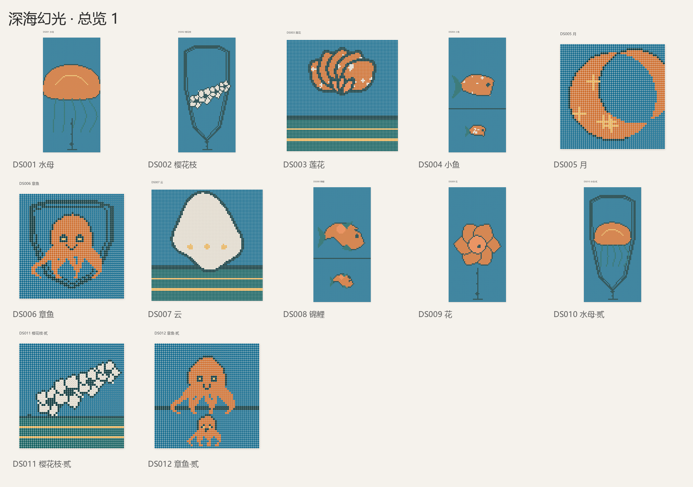
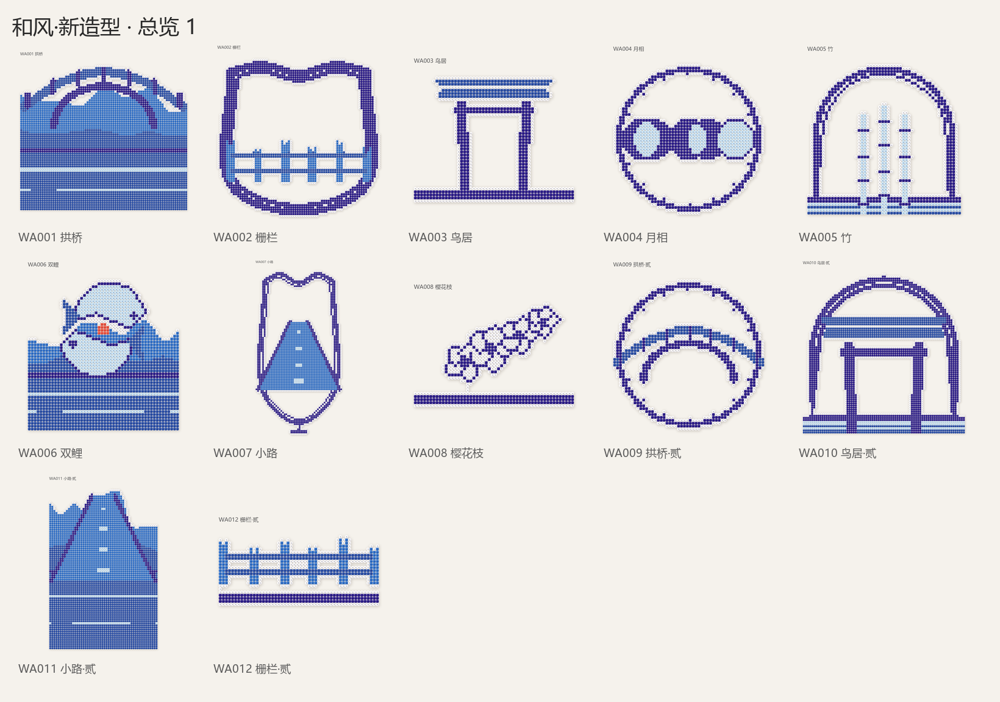
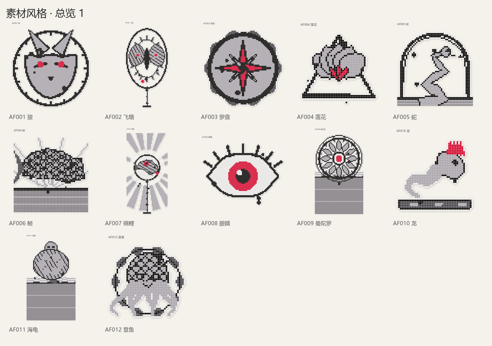

# 公子图纸原创 · Gongzi Original

**任意风格的参考图 → 一整套能卖、能举证原创的拼豆图纸。** 参考图只用来量风格（配色、线宽、纹理、构图比例），画面全部由代码从零画出来——所以换什么画风都能做，而且不侵权。

不依赖任何特定平台。Python 3.9+，命令行。

## 📺 看看效果

[](screenshots/overview-deepsea.png)

> 一张水下摄影参考图 → 12 款同气质原创图纸（深青 + 橙金，4–7 色）

## What This Does

丢一个参考图文件夹进来，出来是一整套可以直接卖的系列：每款四件套 + 总览 + 台账 + 原创性报告。

### Key Features

- **风格包驱动** — 15 个内置画风（墨纹 / 马卡龙 / 波普 / 像素 / 曼陀罗 / 和风 / 低多边 / 赛博 / 植物 / 彩窗 / 国风 / 北欧 / 落日 / 日系赛璐璐 / 深海幻光），换风格只改 JSON 不改代码
- **参考图自动量化** — 主色占比、明暗分布、边缘密度、线宽、对称性、直接缩图的糊格率，10 项指标出风格 DNA
- **出图质量闭环** — 每款最多画 4 遍（原样 / 平涂 / 满幅 / 内轮廓），按"主体面积、色阶、碎点、难度"打分择优；168 款全量平均质量 **0.922**
- **真实色号** — 理想色经 CIEDE2000 匹配到 MARD 291 色 / 72 色套装的真实色号，附 ΔE 误差，买得到豆
- **工艺底线写进代码** — 线宽 ≥1.2 格、细线自动落单颗、纹样周期 ≥3 格、碎块 <30 格删、整件四邻连通、1 格白豆托底
- **原创性核查** — 与参考图 NCC <0.75、款间 NCC <0.92，附报告；超了就重画，不调阈值
- **85 个造型 / 18 个构图 / 15 种纹理** — 走兽飞羽、海洋花草、天象器物、符号萌物、风景道具、人物头像

## Installation

### WorkBuddy

```bash
git clone https://github.com/chengangrun-ai/gongzi-original.git ~/.workbuddy-ai/skills/gongzi-original
pip install -r ~/.workbuddy-ai/skills/gongzi-original/requirements.txt
cd ~/.workbuddy-ai/skills/gongzi-original && python scripts/pindou.py selftest
```

### Claude Code / 其他 Agent

```bash
mkdir -p ~/.claude/skills/gongzi-original
cp -R SKILL.md README.md requirements.txt pindou scripts styles assets references \
      ~/.claude/skills/gongzi-original/
pip install -r ~/.claude/skills/gongzi-original/requirements.txt
```

`selftest` 通过 = 环境没问题，可以接真图。

## Usage

```bash
# 看有什么
python scripts/pindou.py styles      # 15 个风格包
python scripts/pindou.py motifs      # 85 造型 / 18 构图 / 15 纹理

# 参考图 → 自动风格包 → 整套图纸（一步到位）
python scripts/pindou.py auto <参考图目录> --n 12 --out out/新系列 \
    --name "深海幻光" --subjects jellyfish,lotus,moon --refs <参考图目录>

# 用现成风格
python scripts/pindou.py build --style kawaii_pastel --n 24 --out out/萌系 --prefix KW

# 只做原创性核查
python scripts/pindou.py check out/新系列 --refs <参考图目录>
```

产出：

```
out/新系列/
├── 色号图/XX001_名字_色号图.png    每格写色号，10 格红线、5 格虚线、行列坐标
├── 原画/XX001_名字_原画.png        矢量重放，做封面
├── 效果图/XX001_名字_效果图.png    模拟熨烫，带高光豆孔投影
├── 网格/XX001.txt                 作品原件（3 行文件头 + 每行一排豆）
├── 总览_1.png                     25 款一张，人工挑刺
├── 目录.csv / catalog.json        台账 + 质量分
├── 原创性报告.md                  与参考图、款与款的相似度
└── 系列名_全套.zip
```

## Gallery

[](screenshots/overview-ukiyoe.png) [](screenshots/overview-ink.png) [](screenshots/art-octopus.png)

> 左：和风 12 款（鸟居 / 竹 / 樱 / 拱桥 / 双鲤 / 月相）｜中：墨纹 12 款（黑白灰 + 一点红）｜右：深海幻光单款原画

## Architecture

| 文件 | 作用 | 何时加载 |
|---|---|---|
| `SKILL.md` | 触发条件、三步流程、边界、题材对照表 | 每次会话 |
| `README.md` | 人类和 Agent 的入口文档 | 需要安装/理解时 |
| `pindou/palette.py` | 色卡、角色化配色、CIEDE2000 匹配 | 定配色时 |
| `pindou/geom.py` | 纯 numpy 几何：样条、偏移、锥形、对称轮廓 | 加造型时 |
| `pindou/canvas.py` | 显示列表 → 超采样 → 加权表决成网格 | 渲染时 |
| `pindou/motifs.py` | 85 个参数化造型 | 加题材时 |
| `pindou/comp.py` | 18 个构图模板（含场景分层、竖幅纵向排版） | 换构图时 |
| `pindou/brushes.py` | 15 种填充纹理 + 笔刷 | 换质感时 |
| `pindou/stylepack.py` | 风格包加载、校验、从 DNA 合成 | 换风格时 |
| `pindou/recipes.py` | 方案编排 + 质量评分 + 多轮择优 | 出图时 |
| `pindou/beadify.py` | 闭运算、填洞、白边、碎块桥接、难度 | 拼豆化时 |
| `pindou/analyze.py` | 参考图量化（10 项指标） | 分析参考图时 |
| `pindou/originality.py` | NCC + dHash 原创性核查 | 交付前 |
| `pindou/chartkit.py` | 色号图 / 原画 / 效果图 / 总览 / 台账 | 出图时 |
| `references/风格包规范.md` | 风格包字段逐条说明 | 加风格时 |
| `references/原创红线与验收.md` | 红线、算法、验收清单 | 交付前 |
| `docs/optimization_100_v4.md` | 200 项优化的逐条记录 | 复盘时 |

## Philosophy

1. **风格不受保护，表达受保护。** 所以只统计风格规律（配色比例、线宽、纹理密度、构图比例），画面由代码从零画——样条、几何、程序化纹样，控制点都是手写坐标。
2. **不描图、不取样、不图生图。** 代码里没有任何"读参考图"的路径，唯一读图的是 `analyze.py`，只输出数字。
3. **可复现才有资格叫原创。** 固定种子 → 同一份配置永远画出同一张图，逐格可复现，可作存证。
4. **质量分是一等指标。** 主体面积 <0.22 判废、色阶 <3 色封顶、碎点 >30% 封顶。宁可重画，不发次品。
5. **工艺约束优先于美术效果。** 线太细会断、纹样太密会糊、碎块会掉——这些不是建议，是硬门槛，写在代码里。
6. **配置驱动，不写死。** 换风格只改 JSON，换题材只加一个 20 行的函数。

## 边界（必须知道）

| | 能力 | 说明 |
|---|---|---|
| **风格** | ✅ 任意 | 配色/线宽/纹理/明暗/构图比例都从参考图统计，风格包是纯数据 |
| **题材** | ⚠️ 85 个造型 | 库外题材要新写造型（约 20 行） |

- **风景照片** → 能（`scene` 四层构图 + 丘陵/树林/水面/小屋/小船/灯塔/拱桥/栅栏/小路/鸟居）
- **人物照片** → 只能做**原创头像**（`bust`/`chibi`），不还原相貌；要还原本人请用 [pindou-gongzi](https://github.com/chengangrun-ai/pindou-gongzi)（照图转图纸）
- **动漫角色** → 只能做**同风格原创角色**，不复刻具体角色（IP 红线）

## Requirements

- Python 3.9+
- `pip install -r requirements.txt`（numpy / pillow / scipy）
- **不需要 cairo / opencv**
- 中文字体：Windows 自带微软雅黑；macOS 苹方；Linux 装 Noto Sans CJK

## Credits

Created by 公子 · [@chengangrun-ai](https://github.com/chengangrun-ai).

## License

MIT — Use it, modify it, share it.
